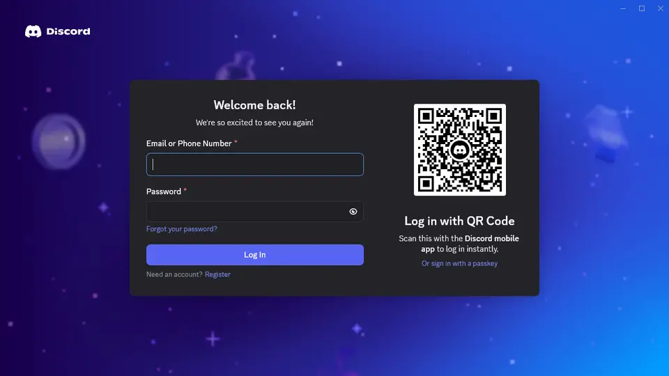
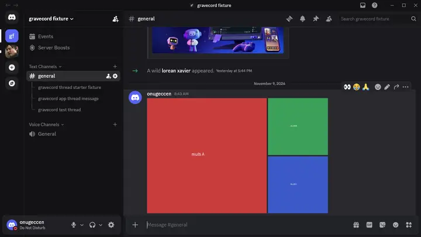
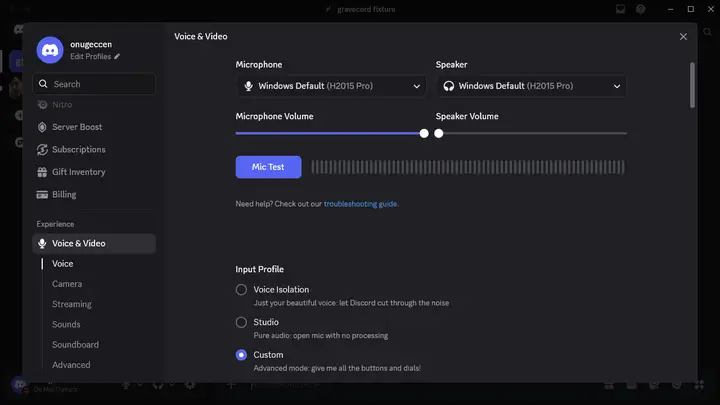
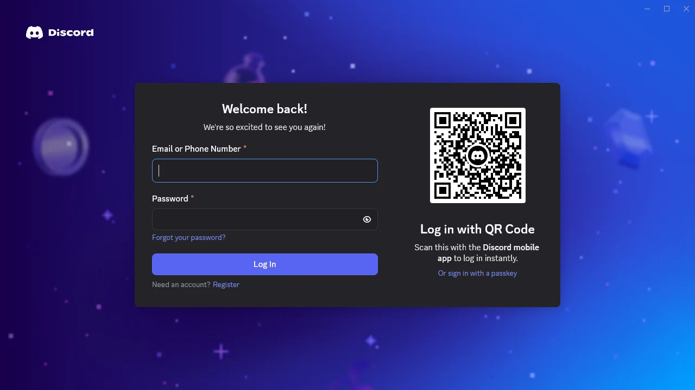
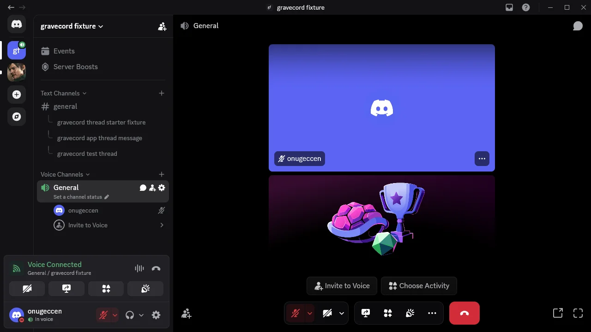
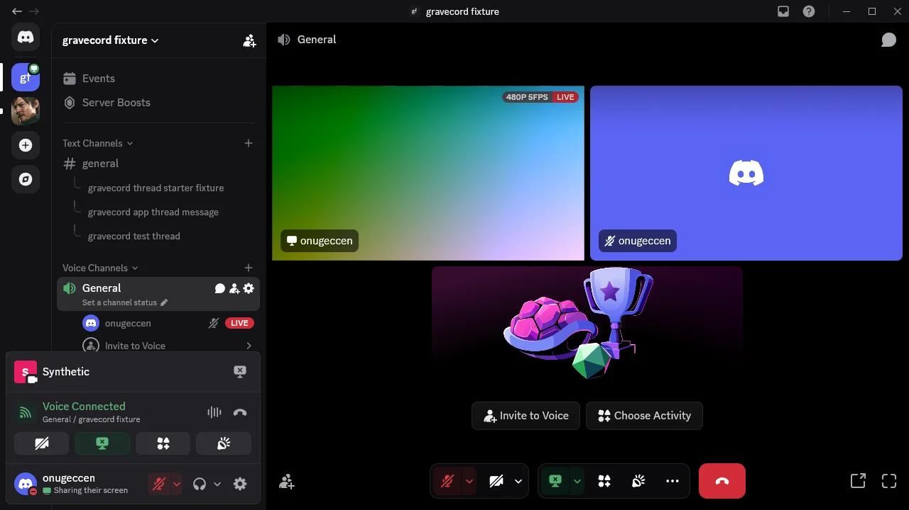
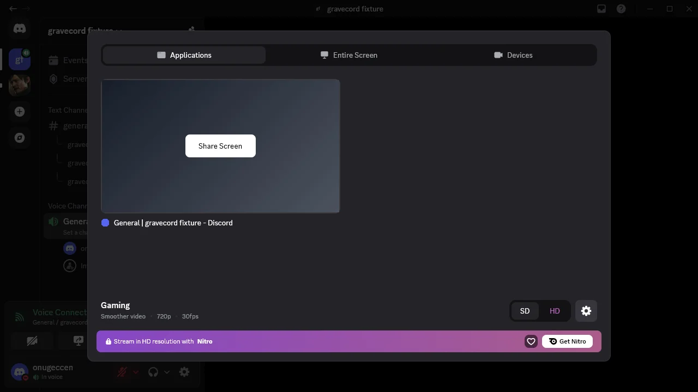
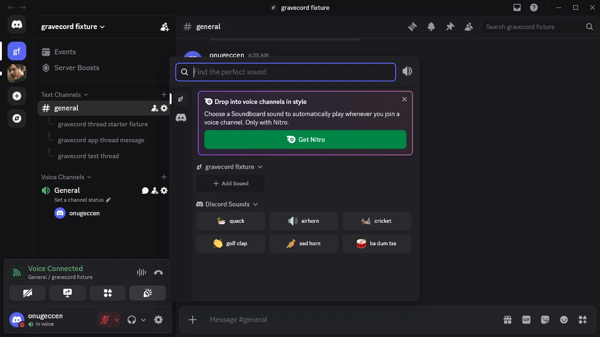
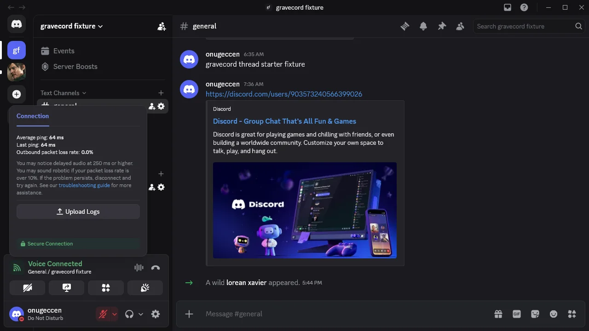

<div align="center">

# gravecord

**A native Discord client written in Rust. No Electron, no browser, the same look.**

<a href="https://www.patreon.com/loreanxavier"></a>




**[Why](#why) · [What works](#what-works) · [Screens](#screens) · [Voice and video](#voice-and-video) · [What is missing](#what-is-missing) · [Building](#building) · [Support](#support)**

</div>

> [!IMPORTANT]
> **gravecord is made by one person in their spare time.** If you want to see it finished, please consider supporting it on [**Patreon**](https://www.patreon.com/loreanxavier).

> [!WARNING]
> **There is no release yet.** Parts of it work well, others are not built. It is an unofficial client, not made or endorsed by Discord, and third-party clients are against Discord's terms: using one is your own decision, on your own account.

## Why

The official desktop client is a whole web browser. gravecord is the same client rebuilt as one native program: Rust from top to bottom, drawn on the GPU with [GPUI](https://github.com/zed-industries/zed), with no web page behind the interface.

The aim is not a Discord-like app with its own ideas. It is the real thing, screen for screen and pixel for pixel, and every button has to do what the button does in the official client. Each screen is compared against captures of the official build, element by element, and the frames are read side by side before it counts as done.

<table>
  <tr>
    <td align="center"></td>
    <td align="center"></td>
  </tr>
  <tr>
    <td align="center"><b>Chat</b><br><sub>messages, embeds, threads, @ # : suggestions</sub></td>
    <td align="center"><b>Settings</b><br><sub>the real pages, with choices that take effect</sub></td>
  </tr>
</table>

## What works

| | Area | State |
|:-:|---|---|
| ✅ | **Login** | Email and password, QR code, two-factor codes, kept in the Windows Credential Manager. Awaiting its first real login |
| ✅ | **Chat** | Messages, replies, reactions, embeds, threads, polls, uploads, paste, slash commands, search with filters, image viewer |
| ✅ | **Social** | DMs, group DMs, friends, profiles, right-click menus |
| ✅ | **Voice** | End-to-end encrypted calls (DAVE), noise suppression with DeepFilterNet, echo cancellation, push to talk, soundboard |
| ✅ | **Video** | Watching Go Live, sending Go Live, receiving camera, hardware H.264 |
| ✅ | **Servers** | Roles, AutoMod, Community, Onboarding, Discovery, member safety and the rest of server settings |
| 🟡 | **Activities** | The shelf and launching work. Opening one past its sign-in has not been tried |
| 🟡 | **Nitro** | The Nitro page and purchase dialogs up to payment. Subscriber states are still being built |
| ⏳ | **Not yet** | See [what is missing](#what-is-missing) |

## Screens

<table>
  <tr>
    <td></td>
    <td></td>
  </tr>
  <tr>
    <td align="center"><b>Login</b></td>
    <td align="center"><b>Voice channel</b></td>
  </tr>
  <tr>
    <td></td>
    <td></td>
  </tr>
  <tr>
    <td align="center"><b>Go Live</b><br><sub>the picture is a generated test pattern</sub></td>
    <td align="center"><b>Source picker</b></td>
  </tr>
  <tr>
    <td></td>
    <td></td>
  </tr>
  <tr>
    <td align="center"><b>Soundboard</b></td>
    <td align="center"><b>Connection details</b><br><sub>real ping and packet loss</sub></td>
  </tr>
</table>

## Voice and video

The voice engine was tested in live calls against the official client, in both directions:

- **Audio** both ways, with the same voice privacy code on both sides, so the end-to-end encryption really is shared with official clients.
- **Go Live** watched at about 55 frames a second, and a stream from gravecord opened in the official client.
- **Camera** received and decoded in hardware.
- **Noise suppression** runs DeepFilterNet, since Krisp only loads in Discord's own signed app. The switch says what is running.
- **Reduce Room Echo** is an extra that the official client does not have.

<details>
<summary><b>Still unproven in a real call</b></summary>
<br>

- Sending our own camera to someone (capture works, the sending half has only passed a local test)
- Sharing a real screen or window as the source
- Hearing custom soundboard sounds from other servers

</details>

## What is missing

For a first release:

- [ ] Installer and automatic updates
- [ ] Desktop notifications and a checked tray icon
- [ ] One instance at a time, start with Windows
- [ ] Spellcheck
- [ ] Nitro subscriber screens and limits
- [ ] Clips

And after that: DM calls, voice messages, stickers, Stage, Events, Game Overlay, game detection, Rich Presence, Shop, Quests, then macOS and Linux.

## Building

Windows, with a current stable Rust:

```bash
cargo build --release -p gravecord
```

Then run `target\release\gravecord.exe` from the repository, so that it finds `app\assets`.

A few things come from the network when it runs: fonts and member artwork load from Discord's own servers, as they do in the official client. Application branding is bundled: Gravecord artwork is the default, with an Original option under Settings → Appearance. The executable and installer retain the Gravecord icon.

## Support

gravecord is built in spare time. If you want to see it finished, this is the way to help:

<a href="https://www.patreon.com/loreanxavier"></a>
